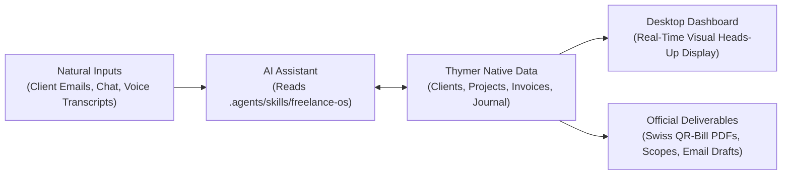

# Freelance OS for Thymer

<p align="center">
  <strong>An autonomous business operating system for freelancers and solo consultants.</strong><br>
  Built for agent-first workflows with native desktop visibility in Thymer.
</p>

<p align="center">
  <a href="https://thymer.com/"></a>
  <a href=".agents/skills/freelance-os/SKILL.md"></a>
  <a href="LICENSE"></a>
</p>

<p align="center">
  <a href="#quickstart">Quickstart</a> ·
  <a href="#everyday-requests">Everyday requests</a> ·
  <a href="#how-it-works">How it works</a> ·
  <a href="#the-desktop-dashboard">Desktop dashboard</a> ·
  <a href="#documentation">Documentation</a>
</p>

---

Freelance OS transforms [Thymer](https://thymer.com) into a complete, private operating system for your freelance business. Instead of spending hours doing manual data entry across disconnected CRMs, project trackers, and spreadsheets, you interact with your **AI assistant as an executive business partner**.

Your assistant handles inbound email triage, scopes projects, tracks retainer budgets, manages deliverables, prepares invoices, and briefs you each morning. The **Thymer Desktop dashboard** serves as your real-time heads-up display.


---

<a id="quickstart"></a>

## Quickstart

Run your freelance business through your AI assistant in two steps.

### 1. Install the Plugin in Thymer

Choose **one** of the two paths:

* **Fresh Workspace:** Follow the [setup guide](docs/setup.md) to initialize the starter schema and collections (`Clients`, `Projects`, `Invoices`, `Support Sessions`).
* **Existing Workspace:** In Thymer, open **Plugins Manager** and install using this repository URL:
  ```text
  https://github.com/jacoplane/thymer-freelance-os
  ```
  Then open **Freelance OS → Settings** to verify your collection mappings.

### 2. Connect Your Coding Assistant

Freelance OS includes built-in agent skills that operate through Thymer's native Model Context Protocol (MCP) server.

1. Enable the MCP server in Thymer Desktop (`Settings → Developers → MCP Server`).
2. Point your AI coding assistant (Antigravity, Claude Code, Cursor, Codex, Gemini CLI) to your Thymer workspace.
3. Paste the prompt below to initialize your assistant:

```text
You are my executive business partner running Freelance OS in Thymer.
Read the freelance-os skill at .agents/skills/freelance-os/SKILL.md.
Connect to my focused Thymer workspace and give me a quick morning briefing:
scan my active projects, today's tasks, waiting items, and outstanding cashflow.
```

Your assistant scans your records and presents your high-signal daily briefing.

---

<a id="everyday-requests"></a>

## Everyday Requests (No Slash Commands Required)

Work naturally with your assistant. No specialized syntax or slash commands are needed:

| What you want to do | What to say to your assistant | What happens behind the scenes |
| :--- | :--- | :--- |
| **Start your day** | *"What's on my plate today?"* or *"Morning briefing"* | Scans tasks due today, flags overdue cash (>14 days), checks waiting blockers, and prioritizes top 3 focus items. |
| **Triage an email / chat** | *"I got this email from Acme: [paste email]"* | Resolves or creates client, captures deal value/source, scopes deliverables into a project, and drafts a ready-to-send reply. |
| **Log time & effort** | *"Logged 2.5h on Acme fixing responsive nav"* | Appends a dated log to the project body; checks month-to-date hours against retainer caps (`included_hours`) and warns of overruns. |
| **Check receivables** | *"Who owes me money?"* | Lists all sent and overdue invoices with days outstanding and total pending cashflow. |
| **Prepare an invoice** | *"Invoice Acme for the branding milestone"* | Cross-references project budget, registers the invoice in Thymer, and bridges to `swiss-invoicing` for official Swiss QR-bill PDF compilation. |
| **Record payment** | *"Acme paid invoice INV-042 today"* | Records payment date, updates payment status to `paid`, and updates the project's billed progress meter. |
| **Weekly strategic review** | *"Let's do the weekly review"* | Audits completed deliverables, flags carryover tasks, formulates next week's 3–5 big rocks, and writes the review directly into your native Journal. |

---

<a id="how-it-works"></a>

## How It Works

Freelance OS bridges autonomous agent workflows with a zero-friction desktop dashboard:



### 1. Unified Client Lifecycle
Leads, active clients, and maintenance retainers share a single lifecycle Status:
$$\text{New lead} \longrightarrow \text{Contacted} \longrightarrow \text{Discussing} \longrightarrow \text{Proposal sent} \longrightarrow \text{Active client} \longrightarrow \text{Maintenance}$$
The assistant tracks prospective deal values (`estimated_value_chf`) and acquisition sources (`source`), giving you a live pipeline view without a secondary sales CRM.

### 2. Project Budgets & Scope Protection
Projects track agreed budgets (`budget_chf`) and contract types (`fixed`, `hourly`, `retainer`, `non_billable`). The assistant continuously compares billed amounts from linked invoices against contracted limits, warning you before out-of-scope work happens.

### 3. Closed-Loop Invoicing & Swiss QR-Bills
Invoices link directly to projects for delivery attribution. When billing in Switzerland or Europe, Freelance OS pairs with the bundled [`swiss-invoicing`](.agents/skills/swiss-invoicing/SKILL.md) skill to compile official Typst-based Swiss QR-bill PDFs with validated QR-IBANs and payment slips.

### 4. Standardized Page Archetypes & Interactive Action Buttons
Clients, projects, invoices, and support sessions maintain standardized markdown archetypes with dedicated sections, automated task rollups, and interactive action buttons:
- **In-Document Action Pills (`linkbtn`):** Native clickable buttons embedded directly into the document canvas (`+ Create project`, `+ Add task`, `+ Add review checkpoint`, `+ Log time`, `+ Create invoice`, `+ Copy payment details`, `+ Add deliverable`, `+ Add follow-up task`).
- **Panel Menubar Header Actions:** Context-aware action buttons pinned to Thymer's top panel menubar (`+ Project`, `+ Invoice`, `+ Time`, `+ Task`, `+ Record payment`, `+ Mark sent`, `Copy details`, `Settled` badge) that open pre-filled modal dialogs without losing document focus.

---

<a id="the-desktop-dashboard"></a>

## The Desktop Dashboard

While your assistant does the heavy lifting, the desktop dashboard provides instant visual clarity whenever you open Thymer:

* **Overview:** High-level cockpit showing monthly recurring revenue (MRR), total billed, cash collected, active projects, and daily agenda.
* **Today:** Pin up to three daily focus tasks, manage your project action queue, and track tasks blocked on clients.
* **Billing:** Searchable invoice register with distinct sending and payment states, currency indicators, and client care plan terms.
* **Weekly Review:** Guided end-of-week reflection that surfaces completed work, overdue items, and saves your weekly plan into Journal.


---

## Autonomous Operations Bench (11 Core Personas)

Freelance OS equips your workspace with an autonomous bench of 11 business operations specialists in `.agents/skills/`, covering every phase of the client lifecycle:

| Persona | Role | Core Directive | Trigger Prompt |
| :--- | :--- | :--- | :--- |
| 🎯 **Proposal Strategist** | Commercial proposals & SOWs | 3-tier proposals with win themes & out-of-scope boundaries | *"Draft a 3-tier proposal for [Client] based on our notes"* |
| 💰 **Pricing Analyst** | Margin defense & Care Plans | Minimum viable price floors with contingency buffers | *"Review budget for [Project] and prepare a Care Plan pitch"* |
| 🔍 **Reality Checker** | Scope skepticism & pre-flight | Stress-tests estimates & deliverables; zero fantasy tolerance | *"Stress-test this quote and project scope before I send it"* |
| 💬 **Discovery Coach** | Sales discovery & qualification | Upfront contracts & situational pain/budget questions | *"Prep me for my discovery call with [Client]"* |
| 📝 **Meeting Notes Specialist** | Call debriefs & decision logging | 4-section executive debrief (Decisions, Actions, Questions) | *"Turn these call notes into a structured 4-section debrief"* |
| 📋 **Senior Project Manager** | Milestone & task breakdown | Converts briefs into 30–60m tasks with review checkpoints | *"Break down the project brief for [Project] into 30-60m tasks"* |
| 🛡️ **Contract Clause Guardian** | MSA, SOW & legal risk auditor | Scans client contracts for toxic liability & IP terms | *"Scan this client agreement for toxic liability or IP clauses"* |
| 🐑 **Client Onboarding Shepherd** | 48-hour client kickoff | Welcome packet, credential intake & kickoff agendas | *"Generate the 48-hour onboarding packet and intake checklist"* |
| 📬 **Receivables Diplomat** | Calibrated invoice recovery | 3-tier escalation reminders that protect cashflow & relationships | *"Check overdue invoices and draft the calibrated reminder"* |
| 🪝 **Lead Gen Offer Architect** | Diagnostic entry offers | Low-friction diagnostic entry audits (performance teardowns) | *"Design a low-friction diagnostic audit to offer prospects"* |
| 📡 **Outbound Strategist** | Signal-based B2B outreach | Identifies hiring surges & tech migrations for 3-touch outreach | *"Draft a 3-touch outreach sequence for [Company] with this signal"* |

---

## Modular Trade Packs (11 Specialized Craft Archetypes)

Activate domain trade packs in the **AI Agents** tab to equip your workspace with specialized project templates, milestone structures, and craft agent skills:

| Trade Pack | Category | Target Roles | Project Archetype & Dedicated Skills |
| :--- | :--- | :--- | :--- |
| 💻 **Software & AI Engineering** | Technology | Full-stack, mobile, AI automation | **Engineering Sprint** (`scope-ticket-translator`, `scope-creep-sentinel`, `plain-english-release-notes`) |
| 🎨 **Design & Creative Direction** | Creative | UI/UX, brand identity, product design | **Design Sprint** (`revision-limit-tracker`, `feedback-consolidator`, `asset-handoff-checklist`) |
| ✍️ **Writing & Content Editorial** | Creative | Copywriters, ghostwriters, content strategists | **Editorial Sprint** (`brief-voice-extractor`, `editorial-status-tracker`, `publishing-package-builder`) |
| 📈 **Growth Marketing & Paid Media** | Marketing | Media buyers, PPC specialists, SEO consultants | **Growth Retainer** (`client-roi-compiler`, `retainer-burn-monitor`, `campaign-preflight-checklist`) |
| 🧭 **Strategy & Management Consulting** | Strategy & Ops | Fractional executives, business strategists | **Advisory Engagement** (`stakeholder-insight-tagger`, `slide-deck-narrative-outliner`, `steering-committee-digest`) |
| 📊 **Accounting & Fractional CFO** | Finance | Bookkeepers, fractional CFOs, tax advisors | **Month-End Close** (`missing-document-chaser`, `month-end-close-tracker`, `financial-health-narrative`) |
| 🗂️ **Executive & Business Support** | Strategy & Ops | Executive assistants, online business managers | **Support Retainer** (`travel-dossier-builder`, `cross-calendar-coordinator`, `daily-action-urgency-queue`) |
| 🎬 **Media & Video Production** | Creative | Video editors, motion designers, videographers | **Production Sprint** (`callsheet-schedule-assembler`, `timestamp-note-consolidator`, `talent-permit-tracker`) |
| 🤝 **HR & Technical Recruiting** | Strategy & Ops | Solo headhunters, talent sourcing consultants | **Recruiting Search** (`candidate-dossier-creator`, `hiring-manager-sla-tracker`, `onboarding-ramp-checklist`) |
| 💍 **Event & Wedding Coordination** | Services | Event producers, wedding planners | **Event Production** (`run-of-show-generator`, `deposit-coi-sentinel`, `vendor-contract-terms-extractor`) |
| 🏡 **Interior Design & Home Staging** | Services | Interior designers, home stagers | **Interior Project** (`ffe-product-spec-builder`, `freight-leadtime-monitor`, `contractor-punchlist-organizer`) |

---

## Universal Coding Assistant Bridge

Connect any agent harness to Thymer in 2 steps:

### 1. Download Workspace Skills
```sh
npx degit jacoplane/thymer-freelance-os/.agents .agents
```

### 2. Connect via MCP
Thymer runs a local MCP server on port `13100`:
* **Google Antigravity:** Add `"thymer": { "url": "http://127.0.0.1:13100/mcp" }` to `mcp_config.json`.
* **Claude Code:** `claude mcp add --transport sse thymer http://127.0.0.1:13100/mcp`
* **Cursor:** Add new SSE server with URL `http://127.0.0.1:13100/mcp`.
* **OpenCode:** `opencode mcp add thymer http://127.0.0.1:13100/mcp`
* **Codex:** `codex mcp add thymer http://127.0.0.1:13100/mcp`
* **OMP:** `omp mcp add thymer http://127.0.0.1:13100/mcp`

---

## Agent Skills Reference

This repository includes two specialized agent skills in `.agents/skills/`:

| Skill | Audience | Description |
| :--- | :--- | :--- |
| **[`freelance-os`](.agents/skills/freelance-os/SKILL.md)** | **End Users / Assistants** | Operational engine for running the freelance business: daily briefings, email triage, project scoping, retainer tracking, and invoicing. |
| **[`freelance-os-plugin-dev`](.agents/skills/freelance-os-plugin-dev/SKILL.md)** | **Plugin Developers** | Autonomous runbook for developing, inspecting, styling, building, and live-verifying the Freelance OS dashboard plugin in Thymer Desktop. |

---

<a id="documentation"></a>

## Documentation

* **[Setup & Installation Guide](docs/setup.md)** — Step-by-step fresh workspace setup and collection configuration.
* **[Daily Workflow & Weekly Review](docs/usage.md)** — In-depth guide to task triage, waiting states, and journal reviews.
* **[Collections & Field Reference](docs/collections.md)** — Complete schema specification for all native collections.
* **[Billing Register](docs/billing.md)** — Invoice lifecycles, payment states, and retainer structures.
* **[Client & Lead Tracking](docs/client-tracking.md)** — Status pipelines, migration from older boards, and MCP workflows.
* **[UI Design System & Style Guide](docs/style-guide.md)** — Visual hierarchy, button tokens, archetype layouts, and panel action pills.
* **[Development & Live Testing](docs/development.md)** — Bundle build, Node test suite, and Puppeteer live desktop verification loop.

---

## Development

Requires Node.js 22 or newer:

```sh
git clone https://github.com/jacoplane/thymer-freelance-os.git
cd thymer-freelance-os
npm ci
node build.mjs
node --test test/*.test.mjs
```

To deploy to a test workspace via MCP:

```sh
node deploy.mjs --workspace YOUR_WORKSPACE_GUID
```

---

## License

MIT © [Jaap Vermeulen](https://github.com/jacoplane)
