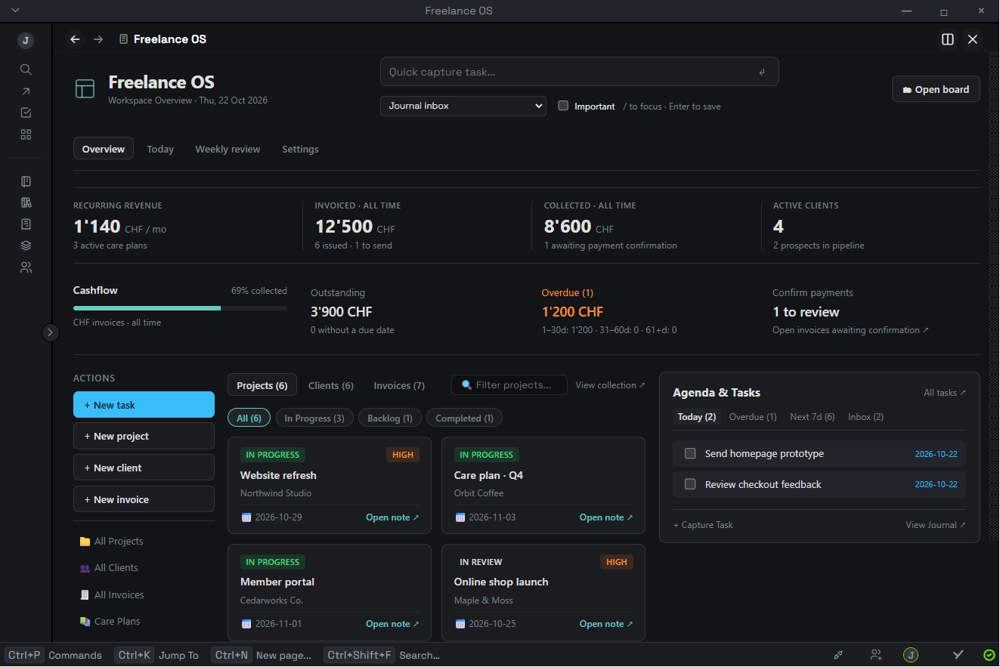
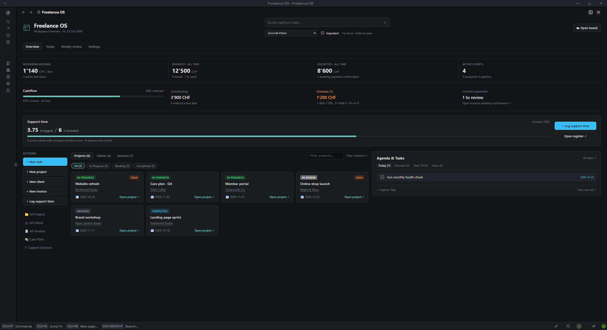
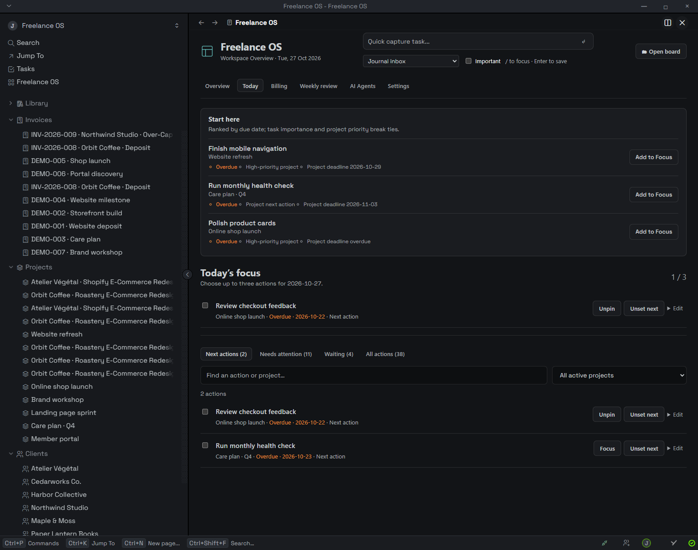
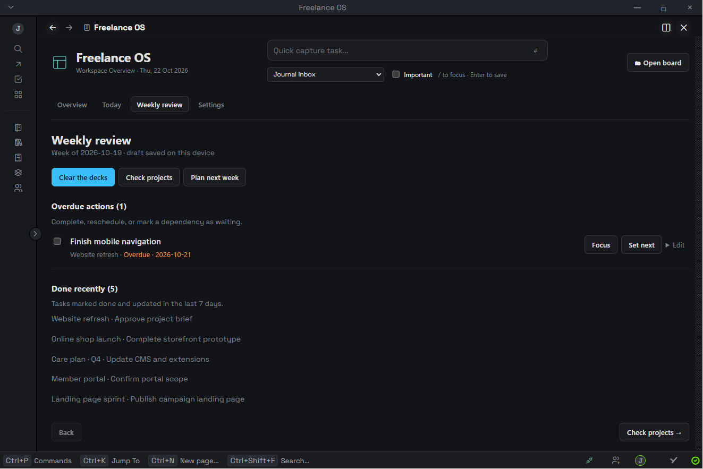

# Freelance OS for Thymer

A home for running a freelance business inside Thymer: clients, projects, cashflow, the next action, and a weekly review.





All screenshots use a separate demo workspace with fictional content.

**[Set up Freelance OS](docs/setup.md)** · **[Daily workflow and weekly review](docs/usage.md)** · **[Collection fields](docs/collections.md)**

## What it does

- **Overview is home.** Recurring revenue, issued invoices, confirmed payments, overdue balances, client relationships, projects and an agenda in one view.
- **Give projects a useful starting point.** Create a native brief, next actions, deliverable links, client review checkpoints and decision log. The checkpoint section uses project tasks and due dates, so approvals stay with the work. Open a project's client profile or filter a client's projects from their card.
- **Move each project forward.** Choose its next action from Today or Weekly review. Freelance OS writes a linked reference under the project’s **Next actions** section, so the choice travels with the project across devices; Overview and the focused queue use that same reference.
- **Pick today’s focus.** Pin up to three project tasks. Search, scope by project and use simple presets such as due/overdue, important or no date. Complete work, reschedule tasks, or record a waiting reason and follow-up date.
- **Close the week.** Clear overdue work, check projects and dependencies, write your wins and next priorities, link a priority to an existing project task or create one, then save the review into Journal with links to those tasks. Freelance OS finds an existing review from another day or device; duplicate matches require an explicit choice instead of silent merging. Last week’s priorities appear beside the plan; carry a waiting or open task forward without creating a second task, or carry an unavailable one as text.
- **Capture from the work.** Run **Capture Freelance OS task for this project** from a native project page. The dashboard opens with that project and its client as the destination, while an existing draft or deliberately chosen destination is preserved.
- **Link unassociated work.** Inbox tasks on a client page or referencing a client can show their active projects as explicit, evidence-backed link choices. Nothing is linked until you choose **Link project**.
- **Track included support time.** Log dated sessions against a client and optional project; the overview totals this month against active clients’ `included_hours` allowances.
- **Stay in Thymer.** Capture native tasks into a project or today’s Journal. Collection links open native working views alongside the dashboard. Layouts adapt to the available panel width.




## Install

Freelance OS has **no required third-party plugin dependencies**. It uses Clients, Projects, Invoices, Library and Support Sessions collections, plus Thymer’s native Journal. The starter setup creates these for you. Daily Focus, Tables and Outline Installer are not required. Plugins Manager is an optional installer.

For a fresh workspace, follow the [setup guide](docs/setup.md). It includes a preview-first setup command and an optional [starter import](dist/freelance-os-starter.json) for Plugins Manager.

If your collections are already configured, install just the dashboard with Plugins Manager using this repository URL:

```text
https://github.com/jacoplane/thymer-freelance-os
```

Then open **Freelance OS → Settings** and check the collection mappings. Collection names can be mapped; field labels and choice values must match the [field reference](docs/collections.md).

## A weekly rhythm

Start in **Overview** to check the business. In **Today**, choose next actions and a small daily focus. At the end of the week, work through **Clear the decks → Check projects → Plan next week**, then save to Journal.



The [usage guide](docs/usage.md) explains capture, waiting work, payment states, and how to update a saved review.

## Current scope

- Financial totals use **CHF**. Other currencies are excluded from CHF totals and are not converted. The dashboard does not generate or send invoices, QR bills, or payment reminders.
- Support time is an optional workflow. `included_hours` is a monthly allowance reference; enter sessions in the Support Sessions collection for automatic month totals. No historical hours are inferred.
- Focus pins, collection mappings and unsaved review drafts are **local to this device and workspace**. Project next actions and waiting details sync through native task references and metadata. Waiting notes saved by an older version remain device-local until you save that waiting entry again. Native tasks, dates, statuses, collection records and saved Journal reviews sync through Thymer.
- “Done recently” means tasks currently marked done whose last modification was within seven days. It is not an exact completion history.
- Active project workflows require `in_progress` or `in_review` status. Field labels and choice values currently follow the provided starter schema.

## Development

Requires Node.js 22 or newer for the setup scripts. Development and live UI checks also use npm dependencies.

```sh
npm ci
node build.mjs
node --test test/finance.test.mjs test/collection-views.test.mjs test/workflow.test.mjs test/starter.test.mjs test/projects.test.mjs
node deploy.mjs --workspace YOUR_WORKSPACE_GUID
```

The build produces the installable root bundle, matching `dist/` files, and a schema-only starter import. Deployments always require an explicit workspace. See [development and screenshot notes](docs/development.md) for the live verification loop and demo seed command.

Feedback and bug reports are welcome in [GitHub Issues](https://github.com/jacoplane/thymer-freelance-os/issues). Include the Thymer version, the affected dashboard tab, and reproduction steps using fictional data where possible.
