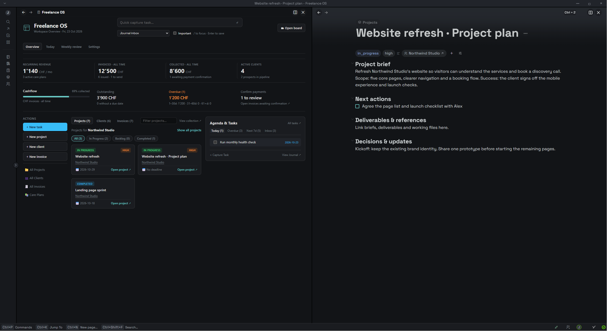
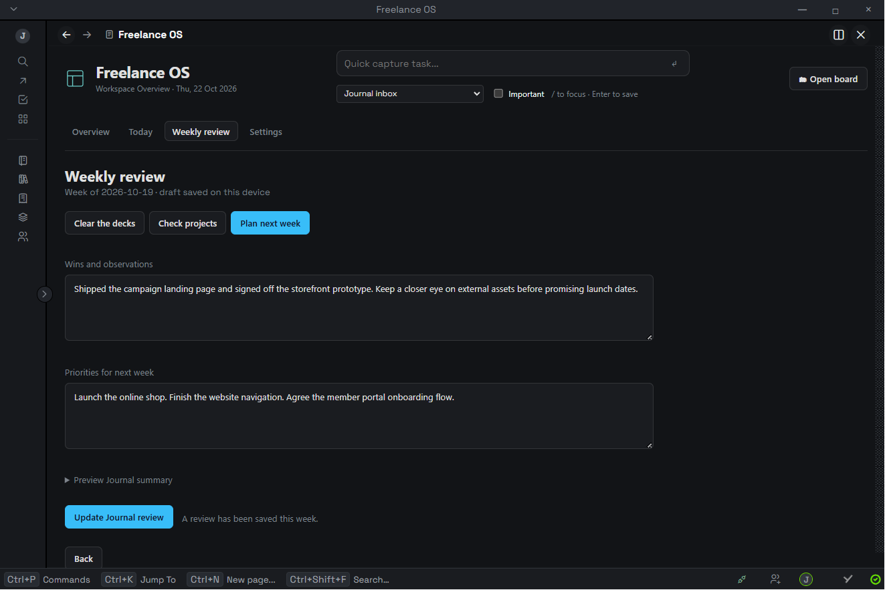

# Use Freelance OS

## Overview: check the business

Overview is the default landing tab. The four metrics show recurring revenue from active clients, issued invoices, confirmed collected payments, and active client count. Financial totals are all time and in CHF.

The cashflow row separates outstanding, overdue and unconfirmed payments. Drafts are counted as work to send, without inflating issued revenue. A due date strictly before today makes a sent, unpaid invoice overdue. Clicking a cashflow action opens the matching native invoice queue beside the dashboard.

Use **Projects / Clients / Invoices** to change the main card list. Project cards open the real project page; client cards show linked project counts and confirmed payments; invoice filters narrow the displayed cards. **View collection** opens the corresponding native working view.

## Capture work quickly

Use the capture field at the top of any tab. Choose **Journal inbox** or an active project, optionally mark the task **Important**, type the task, and press **Enter**. `/` focuses capture when you are not already typing into another field. Capture creates an ordinary Thymer task you can edit from its native page.

The Overview agenda’s **Inbox** skips unfinished tasks on records whose `type` is **template**. Keep reusable checklists marked as templates in Library; after copying their tasks into a real client or project page, those tasks appear as normal work.

Create a new client, project or invoice using the Overview action rail. The invoice action records an issued invoice with separate sent stage and payment state; draft or ready invoices can be maintained in the native Invoices collection. This is an invoice register, not a PDF generator or email sender.

## Start and connect projects

**New project** creates and opens a native Thymer page with four editable sections: **Project brief**, **Next actions**, **Deliverables & references**, and **Decisions & updates**. Add an optional brief and first action in the form; the first action becomes an ordinary Thymer task. If you leave it blank, the page has an empty task ready for you to fill in.

Choose a client in the form to set the project's native **client** property. The client name on a project card opens that client profile. From a client card, click its project count to see only that client's projects; **Show all projects** clears this filter. Counts use actual record links, so similarly named clients and projects are never joined by a title guess. Native client profiles also expose these property references in Thymer's backlinks.

For a project created from the collection itself, open the page and run **Apply Freelance OS project template** from the command palette. The command only fills empty pages or the exact imported migration placeholder. Existing briefs, tasks and notes are preserved. Applying it to an imported hub also adds native references to its existing sub-pages. Template content is ordinary Thymer data and remains editable without Freelance OS.

The starter schema restricts project and invoice Client pickers to the Clients collection. After changing collection mappings, check this picker restriction in your native collection settings as well. Unlinked internal projects are valid; the dashboard shows **Internal / no client linked**. Template records belong in Library rather than the Clients or Projects registers.

Log support work from Overview with **Log support time**. Choose a client, optionally link one of that client’s projects, then enter the date, decimal hours and a short description. The month total counts sessions by their date and compares them with active clients’ `included_hours` values. Set that field to the monthly allowance for each care plan; the dashboard never guesses historical hours.

New project pages also include **Client review checkpoints**: a blank native task and a short reminder to name the deliverable and set the feedback due date. Add one task for each review; mark it complete when the client replies. Existing Freelance OS project templates gain this section when you choose **Apply Freelance OS project template** on that project page.

## Today: move projects forward

Today only includes tasks associated with explicitly active projects (`in_progress` or `in_review`). Tasks on nested project pages are included. A task elsewhere in the workspace can be included when it references exactly one project unambiguously.

1. Open **Needs attention**. Missing next actions, near deadlines, overdue project tasks and due follow-ups appear here.
2. Choose an existing task and click **Set next**. Choose one next action for each active project, or use **Add task** to capture one into that project. The selected task is also linked under the project page’s **Next actions** section, so the choice syncs with the workspace and stays visible outside Freelance OS.
3. Use **Focus** to pin up to three tasks for today. **Unpin** removes a task from that daily shortlist. Pins belong to the selected calendar day.
4. Use the next-action, all-action and waiting tabs to work through the queue. Search and project filters combine.

A checkbox completes the native task. Clicking the task title opens its source page. **Edit** exposes its due date and waiting controls. Changing a due date preserves the task’s other text, links and formatting.

## Track waiting dependencies

In a task’s editor, enter a waiting reason and follow-up date, then save the waiting state. The native task becomes waiting, while the reason and follow-up stay in Freelance OS on this device. Waiting tasks leave the actionable queue and daily shortlist and appear under **Waiting**.

When the follow-up date arrives, the project gains a **Follow-up due** attention signal. Resume the task when the dependency is resolved. These are dashboard reminders; nothing is sent to a client automatically.

## Weekly review

The review is grouped by the week starting Monday. Its draft is saved on this device as you move through three steps:

1. **Clear the decks.** Complete or reschedule overdue actions, or mark dependencies waiting. Look over tasks marked done and updated within the last seven days.
2. **Check projects.** Review every active project, confirm its current next action, and check deadlines and waiting follow-ups. The selected actions carry into **Today → Next actions** and the saved Journal review.
3. **Plan next week.** Write wins and observations, then add one priority per line. For each priority that belongs to active project work, choose its project and either select an existing open task and click **Link task**, or click **Create task**. The task appears in the action queue without changing that project's chosen next action; the priority stays in your review, and the Journal entry links it to the task. Unconverted priorities remain plain text. Inspect the Journal preview and click **Save review to Journal** when ready.

The saved native Journal section includes project next actions, waiting work, overdue counts, recent done tasks, notes and priorities. Converted priorities link directly to their native project tasks. Next-action links on project pages are native workspace content; focus pins, waiting notes, and unsaved review drafts remain local to this device. Saving again during the same week updates the same Journal section, including if you return on another day. After saving, the button becomes **Update Journal review**.

The recent-done list is based on last modification time. Editing an older completed task can make it appear here; it should not be read as an exact completion log. If a task scan is incomplete, the dashboard warns you and does not invent missing-task gaps.

## Keep collection pages useful

The dashboard complements the collection pages. Use them for editing record properties and scanning full registers:

| Collection | Starter working views |
| --- | --- |
| Projects | Register, Board, Active, Due dates, Overdue |
| Clients | Directory, Active, Prospects, Care plans |
| Invoices | Register, Outstanding, Overdue, To confirm, To send, Paid |

Records and views remain native Thymer data. Opening the dashboard does not rewrite collection settings. Split panels adapt to their container width; no desktop window resizing is needed.

## What syncs

| Syncs through Thymer | Local to this device and workspace |
| --- | --- |
| Clients, projects, invoices and linked properties | Collection mappings |
| Native task text, dates, importance and completion/waiting state | Daily focus pins and project next-action selections |
| Saved Journal reviews | Waiting reasons/follow-up dates and unsaved review drafts |

Freelance OS works independently of Daily Focus. Removing Daily Focus does not affect this plugin’s task capture, action queue or weekly review.
